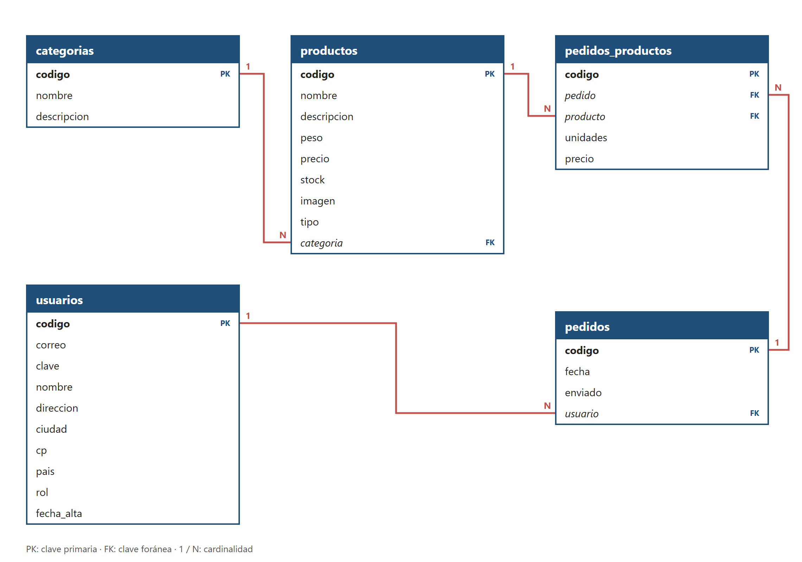

# La Pulpería

**Tienda online de productos argentinos**

Memoria del proyecto · Desarrollo Web en Entorno Servidor · 2.º DAW · ILERNA

| | |
| --- | --- |
| **Alumno** | Martín Villagra Tejerina |
| **Profesor** | Fran Soltero |
| **Entrega de la memoria** | 12 de noviembre de 2026 |

## Índice

- [La Pulpería](#la-pulpería)
  - [Índice](#índice)
  - [1. Definición del proyecto](#1-definición-del-proyecto)
    - [1.1. Qué es La Pulpería](#11-qué-es-la-pulpería)
    - [1.2. Por qué este proyecto](#12-por-qué-este-proyecto)
    - [1.3. Alcance y método de trabajo](#13-alcance-y-método-de-trabajo)
    - [1.4. Tecnologías](#14-tecnologías)
    - [1.5. Catálogo](#15-catálogo)
  - [2. Especificación de requisitos (ERS)](#2-especificación-de-requisitos-ers)
    - [2.1. Propósito](#21-propósito)
    - [2.2. Usuarios del sistema](#22-usuarios-del-sistema)
    - [2.3. Requisitos funcionales](#23-requisitos-funcionales)
    - [2.4. Requisitos no funcionales](#24-requisitos-no-funcionales)
    - [2.5. Cookie y variables de sesión](#25-cookie-y-variables-de-sesión)
    - [2.6. Modelo de datos](#26-modelo-de-datos)
    - [2.7. Clases](#27-clases)
  - [3. Prototipo de pantallas](#3-prototipo-de-pantallas)
    - [3.1. Flujo de pantallas](#31-flujo-de-pantallas)
    - [3.2. Pantallas](#32-pantallas)
  - [4. Limitaciones](#4-limitaciones)
  - [5. Líneas futuras](#5-líneas-futuras)
  - [Anexo A. Usuarios de prueba](#anexo-a-usuarios-de-prueba)
  - [Anexo B. Investigación de precios de las yerbas](#anexo-b-investigación-de-precios-de-las-yerbas)

## 1. Definición del proyecto

### 1.1. Qué es La Pulpería

La Pulpería es una tienda online de productos argentinos pensada para quienes viven en Europa: yerba mate, mates y bombillas, termos, alfajores, dulce de leche y productos de almacén.

El nombre viene de las pulperías, los almacenes de campo de la época gaucha donde se compraba la yerba, el azúcar y el tabaco, y donde se juntaba la gente del pago.

El cliente entra con su correo y su clave, recorre el catálogo por categorías, arma un carrito y hace el pedido. El pedido queda guardado en la base de datos con el precio del día de la compra.

### 1.2. Por qué este proyecto

Antes de elegir el tema se revisaron siete tiendas que venden productos argentinos en Europa: Pampa Drugstore (Barcelona), Mate-Tee (Alemania), MateMundo (Reino Unido), Casa Argentina (Londres), Patagonia Online (Reino Unido), UruShop (Reino Unido) y La Reinita (Ámsterdam).

De esa revisión salen tres conclusiones:

- Todas venden yerba mate, y la mayoría también accesorios de mate, alfajores, dulce de leche y kits de regalo. Con eso se definieron las seis categorías de la tienda (apartado 1.5).
- Las webs del rubro, también las de Argentina y Uruguay, tienen en general un diseño anticuado. Hay lugar para una tienda con una imagen cuidada.
- La misma yerba cuesta en Europa entre 2,5 y 3 veces más que en Argentina. Los precios de la tienda se fijaron con esa referencia (Anexo B).

Ninguna de las tiendas revisadas usa el nombre «La Pulpería».

### 1.3. Alcance y método de trabajo

El proyecto se divide en tres partes, que se entregan por separado:

| **Fecha** | **Entrega** |
| --- | --- |
| 12/11/2026 | Memoria: definición, requisitos (ERS), prototipo de pantallas y limitaciones. |
| 19/11/2026 | Parte 1 (gestor de productos) y parte 2 (control del usuario). |
| 02/12/2026 | Parte 3 (carrito y pedidos) y entrega final. |

Se sigue un modelo en espiral, como el que propone el libro de la asignatura: en cada parte se repasan los requisitos, se diseña, se programa y se prueba antes de pasar a la siguiente. Si un requisito cambia, se actualiza también esta memoria, para que memoria y código digan siempre lo mismo.

### 1.4. Tecnologías

| **Tecnología** | **Uso** |
| --- | --- |
| PHP 8.2 | Lógica del servidor, con programación orientada a objetos. |
| MariaDB 10.4 (MySQL) | Base de datos relacional «pulperia», con codificación utf8mb4. |
| PDO | Conexión de PHP con la base de datos, con consultas preparadas. |
| HTML, CSS y JavaScript | Páginas, estilos y efectos visuales. JavaScript solo se usa para animaciones y comodidades (ver la clave, reiniciar el gif, mostrar en el celular la opción elegida del filtro); la lógica de la tienda corre en el servidor. |
| XAMPP | Servidor local (Apache + MariaDB) para desarrollar y probar. |
| GSAP, Google Fonts y Phosphor Icons | Animaciones de entrada, tipografías (Anton, Bricolage Grotesque y Permanent Marker) e iconos, cargados desde CDN. |
| Figma | Prototipo de las pantallas. |

### 1.5. Catálogo

La tienda tiene 6 categorías y 70 productos, por encima del mínimo pedido (3 categorías y 8 productos):

| **Categoría** | **Productos** | **Tipos (filtro, RF-18)** | **Ejemplos** |
| --- | --- | --- | --- |
| Yerbas | 30 | Con palo, sin palo, compuesta, orgánica, barbacuá, saborizada, chimarrão | Playadito, Taragüí, Canarias, Baldo, Sara, La Merced Barbacuá, Kraus Orgánica |
| Mates y bombillas | 8 | Mates, bombillas | Mate imperial, mate camionero, bombilla pico de loro |
| Termos y materas | 8 | Termos, materas, pavas, yerberas | Termo Stanley, termo Lumilagro, pava con control de temperatura, matera Broksol |
| Alfajores y dulce de leche | 8 | Alfajores, dulce de leche | Havanna, Cachafaz, Guaymallén, dulce de leche La Serenísima |
| Almacén criollo | 8 | Para el mate, para el asado, dulces, para cocinar | Chimichurri, Mantecol, Criollitas, dulce de membrillo Esnaola |
| Kits y regalos | 8 | Para el mate, para comer | Kit de iniciación, kit matero, kit viajero |

Cada categoría tiene su propia plantilla de descripción, para que todos los productos de una categoría den la misma información:

| **Categoría** | **Qué dice la descripción** |
| --- | --- |
| Yerbas | Tipo de yerba y lugar de origen, empresa que la elabora, intensidad del sabor y un dato propio de la marca. |
| Mates y bombillas | De qué está hecho, cómo está terminado (forro, virola, filtro, largo), para quién es y un cuidado o dato propio. |
| Termos y materas | Material y capacidad, qué tiene para cebar, cuánto mantiene el agua o qué lleva, y un dato propio. |
| Alfajores y dulce de leche | Cómo es (tapas, relleno, baño), quién lo hace, cómo viene y un dato propio. |
| Almacén criollo | Qué es, de qué marca, cómo se usa y un dato propio. |
| Kits y regalos | Qué trae y para quién es. |

Los materiales y las medidas de los mates, bombillas y termos siguen el catálogo de Nuestra Pacha Regionales (Córdoba, Argentina), una tienda real del rubro: calabaza forrada en cuero, faja y virola de alpaca, bombillas de 16 a 18 cm con filtro de cuchara o de resorte.

## 2. Especificación de requisitos (ERS)

### 2.1. Propósito

Este apartado describe qué hace la aplicación. Cada requisito lleva un código (RF para los funcionales, RNF para los no funcionales) para poder localizarlo en el código fuente. Lo que no se implementa no aparece como requisito: va en Limitaciones (apartado 4) o en Líneas futuras (apartado 5).

### 2.2. Usuarios del sistema

| **Usuario** | **Rol** | **Qué puede hacer** |
| --- | --- | --- |
| Cliente | 0 | Ver el catálogo, usar el carrito, hacer pedidos y ver su perfil. |
| Administrador | 1 | Lo mismo que el cliente y, además, gestionar los productos (RF-04). |

Sin iniciar sesión solo se puede ver la pantalla de login.

### 2.3. Requisitos funcionales

Los códigos no se renumeran: un requisito que se suma después recibe el siguiente número libre (RF-18), aunque se liste en su parte. Así los códigos siguen coincidiendo con los comentarios del código fuente.

**Parte 1. Gestor de productos**

| **Código** | **Requisito** |
| --- | --- |
| RF-01 | Mostrar las categorías leídas de la base de datos, con su nombre y su descripción. |
| RF-02 | Al elegir una categoría, mostrar sus productos con imagen, nombre, descripción, peso y precio en euros, con su equivalente en pesos argentinos. |
| RF-03 | Un producto con stock 0 aparece como «Sin stock» y no se puede añadir al carrito. |
| RF-04 | <mark>PENDIENTE: confirmar con el profesor si el gestor de productos incluye un panel de alta, modificación y baja.</mark> El administrador puede dar de alta, modificar y dar de baja productos. |
| RF-18 | En la página de una categoría, filtrar sus productos por tipo (por ejemplo, en Yerbas: con palo, sin palo, compuesta, orgánica o barbacuá). Los tipos y la cantidad de productos de cada uno se leen de la base de datos, y el filtro se aplica en la consulta. Solo aparece si la categoría tiene más de un tipo. |

**Parte 2. Control del usuario**

| **Código** | **Requisito** |
| --- | --- |
| RF-05 | Iniciar sesión con correo y clave. La clave se comprueba contra el hash guardado en la base de datos. |
| RF-06 | Si el correo o la clave no son correctos, se muestra un error sin indicar cuál de los dos falló. |
| RF-07 | Casilla «Recordar mi correo»: si se marca, el correo se guarda en una cookie y aparece escrito la próxima vez que se abre el login. |
| RF-08 | Todas las páginas, salvo el login, exigen sesión iniciada. Sin sesión, redirigen al login. |
| RF-09 | La sesión caduca tras 10 minutos sin actividad. Al volver, el usuario ve un aviso de sesión caducada y tiene que entrar de nuevo. |
| RF-10 | Página de perfil con los datos del usuario (nombre, correo, dirección, ciudad, código postal, país y fecha de alta) y la lista de sus pedidos. |
| RF-11 | Cerrar sesión desde cualquier página. |

**Parte 3. Carrito y pedidos**

| **Código** | **Requisito** |
| --- | --- |
| RF-12 | Añadir unidades de un producto al carrito. No se pueden añadir más unidades que el stock disponible. |
| RF-13 | Ver el carrito: producto, unidades, precio unitario, subtotal y total, en euros y en pesos. |
| RF-14 | Quitar unidades o un producto entero del carrito. |
| RF-15 | Confirmar el pedido: se guardan el pedido y una línea por producto con sus unidades y el precio del día, y se descuenta el stock. Todo va en una transacción: si algo falla, no se guarda nada. |
| RF-16 | Antes de guardar el pedido se vuelve a comprobar el stock en la base de datos. Si otro cliente compró las últimas unidades, el pedido no se hace y se avisa al usuario. |
| RF-17 | Tras confirmar, se muestra el número de pedido y el carrito queda vacío. |

### 2.4. Requisitos no funcionales

| **Código** | **Requisito** |
| --- | --- |
| RNF-01 | Programación orientada a objetos: la lógica está en las clases del apartado 2.7. |
| RNF-02 | Base de datos relacional. El acceso se hace con PDO y consultas preparadas (prepare y execute); nunca se pegan datos del usuario dentro de una consulta. |
| RNF-03 | Las claves se guardan con password_hash y se comprueban con password_verify. Nunca se guardan en una cookie ni en la sesión. |
| RNF-04 | La aplicación usa una cookie propia y variables de sesión, descritas en el apartado 2.5. |
| RNF-05 | Los precios se guardan en euros. El equivalente en pesos es el precio en euros × 1.700, con la cotización definida en un único lugar del código. |
| RNF-06 | Todo en UTF-8 (base de datos y páginas), para que se vean bien las tildes, la ñ y la diéresis (Taragüí). |
| RNF-07 | Los datos que se muestran en las páginas se escapan con htmlspecialchars, para evitar que se inyecte HTML. |
| RNF-08 | Funciona en local con XAMPP. Las tipografías, los iconos y GSAP se cargan desde internet; sin conexión la tienda funciona igual, con la letra del sistema y sin animaciones. |
| RNF-09 | Lo que se mueve solo (la cinta de arriba, las animaciones de entrada y el cambio de página) respeta la opción «reducir movimiento» del sistema. El gif al pasar el mouse sí se muestra, porque lo pide la persona. |

### 2.5. Cookie y variables de sesión

| **Nombre** | **Tipo** | **Qué guarda** | **Vida** |
| --- | --- | --- | --- |
| recordar_correo | Cookie propia | El correo del usuario. Nunca la clave. | Se crea al entrar con la casilla marcada y dura 30 días. Se borra al entrar con la casilla desmarcada. |
| PHPSESSID | Cookie de sesión de PHP | El identificador de la sesión. La crea PHP solo. | Hasta cerrar el navegador o cerrar sesión. |
| $_SESSION['usuario'] | Variable de sesión | Código, correo, nombre y rol del usuario. | Se crea al iniciar sesión. Se borra al cerrar sesión o al caducar. |
| $_SESSION['carrito'] | Variable de sesión | Array código de producto → unidades. | Se crea al añadir el primer producto. Se vacía al confirmar el pedido. |
| $_SESSION['ultima_actividad'] | Variable de sesión | La hora (time()) de la última página visitada. | Se actualiza en cada página. Si pasan más de 10 minutos, la sesión se destruye (RF-09). |

<mark>PENDIENTE: si el profesor pide que el carrito se guarde en la base de datos, $_SESSION['carrito'] se sustituye por una tabla y se actualiza este apartado.</mark>

### 2.6. Modelo de datos

La base de datos «pulperia» tiene cinco tablas. Las relaciones son:

- Una categoría tiene muchos productos (1:N).
- Un usuario hace muchos pedidos (1:N).
- Un pedido tiene muchos productos y un producto aparece en muchos pedidos (N:M). La relación se resuelve con la tabla pedidos_productos, que guarda también las unidades y el precio del día de la compra. Así, un pedido antiguo no cambia si después sube el precio.

*Figura 1. Diagrama E-R de la base de datos «pulperia».*

**usuarios**

| **Campo** | **Tipo** | **Descripción** |
| --- | --- | --- |
| codigo | INT, PK | Identificador, autoincremental. |
| correo | VARCHAR(100), único | Correo con el que se inicia sesión. |
| clave | VARCHAR(255) | Hash de la clave (password_hash). |
| nombre, direccion, ciudad, cp, pais | VARCHAR | Datos personales y de envío. |
| rol | INT | 0 = cliente, 1 = administrador. |
| fecha_alta | DATETIME | Fecha de alta del usuario. |

**categorias**

| **Campo** | **Tipo** | **Descripción** |
| --- | --- | --- |
| codigo | INT, PK | Identificador, autoincremental. |
| nombre | VARCHAR(50), único | Nombre de la categoría. |
| descripcion | VARCHAR(200) | Texto que se muestra en el listado de categorías. |
| imagen | VARCHAR(150) | Ruta de la imagen del afiche de la categoría (img/categorias/…webp). |

**productos**

| **Campo** | **Tipo** | **Descripción** |
| --- | --- | --- |
| codigo | INT, PK | Identificador, autoincremental. |
| nombre | VARCHAR(100) | Nombre del producto. |
| descripcion | VARCHAR(300) | Descripción. |
| peso | INT | Peso en gramos. |
| precio | DECIMAL(8,2) | Precio en euros. |
| stock | INT | Unidades disponibles. |
| imagen | VARCHAR(150) | Ruta de la imagen (img/productos/…jpg). |
| tipo | VARCHAR(30) | Tipo dentro de su categoría (con palo, bombillas…), para el filtro (RF-18). |
| categoria | INT, FK | Categoría a la que pertenece. |

**pedidos**

| **Campo** | **Tipo** | **Descripción** |
| --- | --- | --- |
| codigo | INT, PK | Número de pedido, autoincremental. |
| fecha | DATETIME | Fecha y hora del pedido. |
| enviado | INT | 0 = no enviado, 1 = enviado. |
| usuario | INT, FK | Usuario que hizo el pedido. |

**pedidos_productos**

| **Campo** | **Tipo** | **Descripción** |
| --- | --- | --- |
| codigo | INT, PK | Identificador, autoincremental. |
| pedido | INT, FK | Pedido al que pertenece la línea. |
| producto | INT, FK | Producto pedido. |
| unidades | INT | Unidades pedidas. |
| precio | DECIMAL(8,2) | Precio unitario en euros el día de la compra. |

### 2.7. Clases

| **Clase** | **Responsabilidad** |
| --- | --- |
| BaseDatos | Abre la conexión PDO una sola vez y la comparte con el resto de clases. |
| Categoria | Lee las categorías de la base de datos, con su cantidad de productos y el precio de su producto más barato, y los tipos de producto de cada una para el filtro. |
| Producto | Lee los productos de una categoría (todos o los de un tipo) o un producto por su código, y consulta el stock. |
| Usuario | Inicia sesión comprobando el hash, comprueba que la sesión siga activa y devuelve los datos del perfil. |
| Carrito | Maneja $_SESSION['carrito']: añadir, quitar, vaciar y calcular el total. |
| Pedido | Guarda el pedido en una transacción y lista los pedidos de un usuario. |

## 3. Prototipo de pantallas

El prototipo está hecho en Figma. <mark>PENDIENTE: enlace al proyecto de Figma.</mark>

### 3.1. Flujo de pantallas

Login → Categorías → Productos → Carrito → Confirmación del pedido.

Desde cualquier pantalla con sesión iniciada se puede ir al perfil, al carrito y cerrar sesión. Si la sesión caduca, cualquier pantalla lleva al login con el aviso de sesión caducada.

### 3.2. Pantallas

| **Pantalla** | **Qué muestra** | **Requisitos** |
| --- | --- | --- |
| Login | Logo, correo, clave con un botón para verla, casilla «Recordar mi correo», botón Entrar y mensaje de error si falla. | RF-05, RF-06, RF-07 |
| Sesión caducada | El login con un aviso arriba: «Tu sesión caducó por inactividad». | RF-09 |
| Categorías | Cabecera común (logo, nombre del usuario, carrito con el número de productos, perfil y salir), una lista de precios con el precio más barato de cada categoría («desde 2,90 €») y un afiche por categoría con su descripción, su cantidad de productos y su imagen, recortada como un sticker. | RF-01, RF-11 |
| Productos | Arriba, el filtro por tipo: una ficha por tipo con su cantidad de productos, y la elegida resaltada con el color de la categoría. Debajo, una tarjeta por producto: imagen, nombre, descripción, peso, precio en euros (y en pesos), unidades y botón Añadir. Los que no tienen stock muestran «Sin stock». Al pasar el mouse, la foto se cambia por un gif del producto girando. | RF-02, RF-03, RF-12, RF-18 |
| Carrito | Tabla con producto, unidades, precio, subtotal y botón Quitar. Total en euros y en pesos y botón Confirmar pedido. | RF-13, RF-14 |
| Confirmación | Número de pedido y resumen. Si falta stock, el aviso correspondiente. | RF-15, RF-16, RF-17 |
| Perfil | Datos del usuario y lista de sus pedidos con fecha, total y estado. | RF-10 |
| Gestor de productos | <mark>PENDIENTE (RF-04).</mark> Listado de productos con botones de alta, modificación y baja. | RF-04 |

<mark>PENDIENTE: insertar una captura de Figma por pantalla.</mark>

## 4. Limitaciones

- **Cotización fija.** El precio en pesos se calcula con 1 € = 1.700 ARS, el valor tomado el 06/11/2026. No se actualiza solo.
- **Sin correos.** Al confirmar un pedido no se envía ningún correo. El libro lo hace con PHPMailer, pero eso exige guardar credenciales de una cuenta de correo.
- **Sin registro.** Los usuarios no se dan de alta desde la web: se crean en la base de datos (ver Anexo A).
- **Sin pago ni envío.** El pedido queda registrado, pero no hay pasarela de pago. El campo «enviado» existe en la base de datos, pero no se gestiona desde la web.
- **Precios.** Los precios de las yerbas se fijaron a partir de una investigación de precios reales (Anexo B); nueve de las catorce que se sumaron el 10/11 no se venden en las tiendas consultadas y su precio es estimado. Los del resto de categorías son estimados.
- **Solo en local.** La aplicación funciona en XAMPP y no está desplegada en un servidor público.
- **Imágenes.** Las fotos de los productos son de los fabricantes y de las tiendas online argentinas donde se venden, y se usan solo con fines académicos. Los kits son fotos armadas juntando las de cada producto. Las imágenes de los afiches de las categorías se hicieron aparte para la tienda y no repiten productos del catálogo.
- <mark>PENDIENTE: si el carrito se queda en la sesión, se pierde al cerrar sesión o al caducar. Confirmar con el profesor.</mark>

## 5. Líneas futuras

- Botón para cambiar la moneda de toda la tienda entre euros y pesos, con la cotización del día.
- Registro de usuarios desde la web.
- Pasarela de pago y seguimiento del envío.
- Envío de un correo de confirmación con cada pedido.
- Nuevas categorías: vinos (exige verificar la mayoría de edad) y carnes (exige cadena de frío y envíos especiales).
- Renders 3D y vídeos de los productos.
- Filtro por tamaño del paquete (500 g, 1 kg), sumado al filtro por tipo.
- Ampliar el catálogo con más mates, bombillas y termos.
- Ofrecer la tienda a comercios reales del rubro.

## Anexo A. Usuarios de prueba

La clave se guarda en la base de datos con password_hash. Estas son las claves para probar la aplicación:

| **Correo** | **Clave** | **Rol** |
| --- | --- | --- |
| admin@lapulperia.es | admin1234 | 1 (administrador) |
| riquelme@correo.com | 1234 | 0 (cliente) |
| messi@correo.com | lio10 | 0 (cliente) |

El producto «Bombilla de alpaca cincelada» tiene stock 0 a propósito, para probar RF-03.

## Anexo B. Investigación de precios de las yerbas

Precios en Argentina consultados el 06/11/2026 en DIA, Jumbo, Vea, Disco, Carrefour y ChangoMás (precio normal, sin promociones). Conversión a 1 € = 1.700 ARS. Las tiendas europeas de referencia fueron Pampa Drugstore, Mate-Tee y UruShop.

**Conclusión:** un kilo de yerba cuesta en Argentina unos 3 € al cambio y en las tiendas europeas entre 7,50 y 11 €. Los precios de La Pulpería están dentro de ese rango, salvo La Merced Campo Sur (12,90 €), que en Europa también se vende más cara (6,67 € el paquete de 500 g).

| **Yerba** | **Argentina (ARS)** | **Argentina (€)** | **La Pulpería (€)** |
| --- | --- | --- | --- |
| Playadito Suave 1 kg | 5.208 | 3,06 | 7,90 |
| Taragüí Con Palo 1 kg | 5.790 | 3,41 | 8,10 |
| Rosamonte 1 kg | 4.490 | 2,64 | 8,50 |
| Amanda Tradicional 1 kg | 5.490 | 3,23 | 8,30 |
| Unión Suave 1 kg | 5.790 | 3,41 | 8,50 |
| Canarias 1 kg | 13.200 | 7,76 | 10,90 |
| CBSé Hierbas Serranas 1 kg | 5.190 | 3,05 | 9,90 |
| La Merced Campo Sur 1 kg | 6.790 | 3,99 | 12,90 |
| Cruz de Malta 1 kg | 5.199 | 3,06 | 8,90 |
| Nobleza Gaucha 1 kg | 4.890 | 2,88 | 7,90 |
| Piporé 1 kg | 5.050 | 2,97 | 8,80 |
| Verdeflor Hierbas Serranas 1 kg | 5.200 (*) | 3,06 | 8,20 |
| Pajarito Tradicional 1 kg | No se vende | – | 8,20 |
| Kurupí Menta y Boldo 500 g | 4.799 | 2,82 | 5,90 |
| Kraus Orgánica 500 g | No se vende | – | 7,70 |
| Andresito Tradicional 1 kg | 3.835 | 2,26 | 8,50 |

(*) En Argentina solo se vende en paquetes de 500 g; el precio del kilo es el doble del paquete.

Pajarito es paraguaya y Kraus se exporta casi entera, por eso no están en los supermercados argentinos. Canarias es uruguaya y en Argentina también es importada, de ahí su precio más alto.

**Yerbas añadidas el 10/11/2026.** Para las 14 yerbas que se sumaron al catálogo se tomó como referencia el precio de Mate-Tee (Alemania), consultado el 10/11/2026. Cinco están a la venta allí; las otras nueve no, y su precio se estimó comparándolas con la yerba más parecida del catálogo (misma empresa, mismo tipo o mismo tamaño).

| **Yerba** | **Mate-Tee (€)** | **La Pulpería (€)** | **Cómo se fijó** |
| --- | --- | --- | --- |
| Aguantadora Tradicional 1 kg | – | 8,20 | Estimado, como las otras con palo de 1 kg |
| Amanda Despalada 500 g | 5,95 | 5,90 | Mate-Tee |
| Baldo 1 kg | – | 11,90 | Estimado, a la altura de Canarias (la misma empresa) |
| Barão de Cotegipe Nativa 1 kg | – | 9,90 | Estimado |
| Cachamate Hierbas Serranas 500 g | – | 5,50 | Estimado, como CBSé Hierbas Serranas 500 g (5,09 € en Mate-Tee) |
| Canarias Serena 1 kg | 12,12 | 11,90 | Mate-Tee |
| CBSé Energía Guaraná 500 g | 5,09 | 5,50 | Mate-Tee |
| La Merced Barbacuá 500 g | – | 7,50 | Estimado, como La Merced Campo Sur 500 g (6,98 € en Mate-Tee) |
| Mañanita 500 g | – | 4,50 | Estimado, la mitad de Unión 1 kg (la misma empresa) |
| Mate Rojo Tradicional 1 kg | – | 8,20 | Estimado, como las otras con palo de 1 kg |
| Natura Orgánica 500 g | – | 6,90 | Estimado, por debajo de Kraus Orgánica 500 g |
| Sara Tradicional 1 kg | 12,84 | 12,50 | Mate-Tee |
| Selecta Tradicional 500 g | 6,36 | 6,30 | Mate-Tee |
| Taragüí Despalada 500 g | – | 5,50 | Estimado, a partir de Taragüí Con Palo 1 kg |

Las uruguayas (Baldo, Canarias Serena y Sara) quedan por encima de los 11 € el kilo, igual que Canarias: también en Europa son las más caras.
